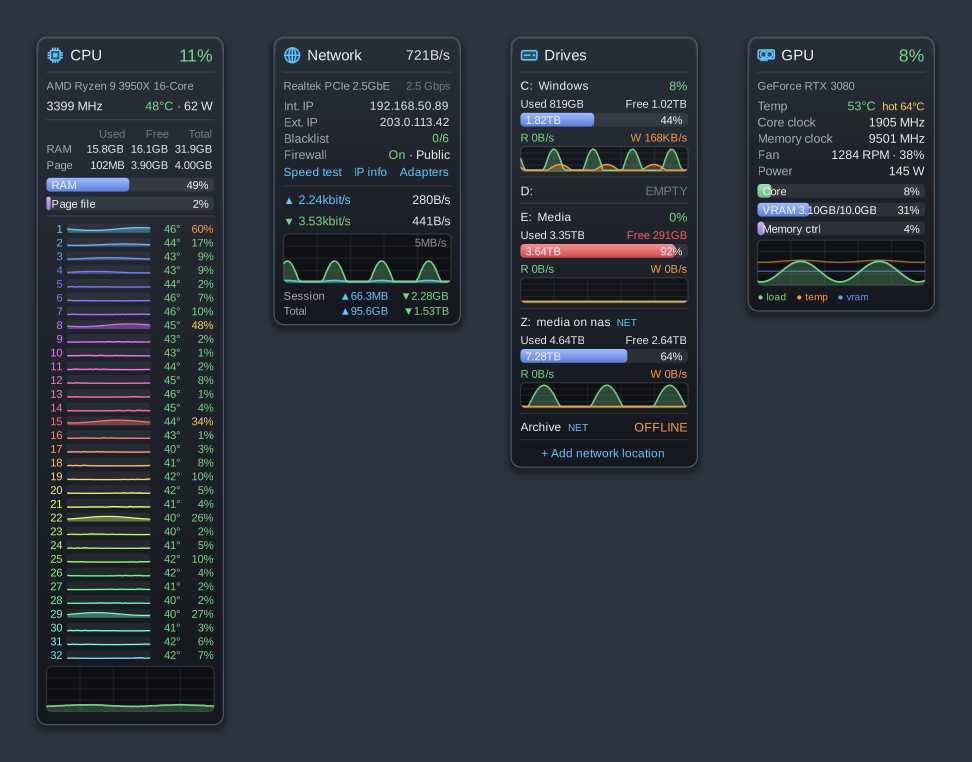
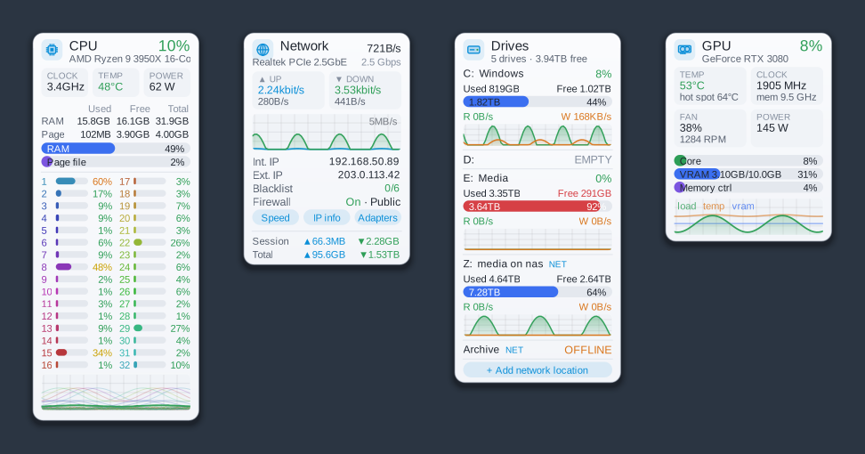
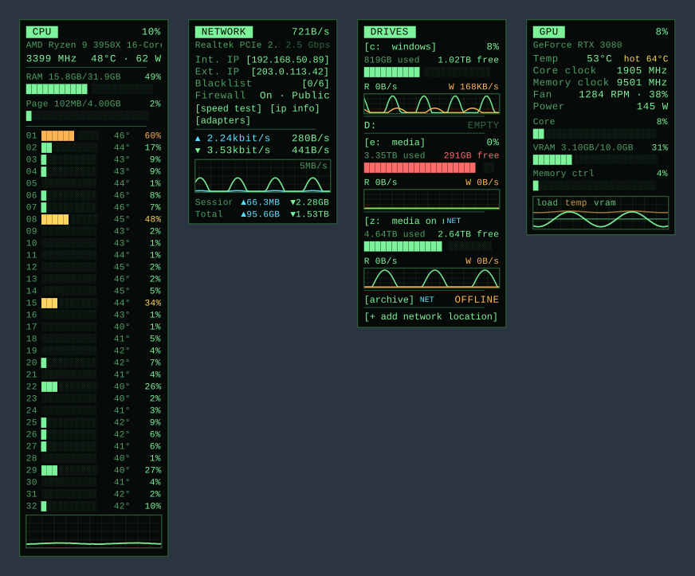
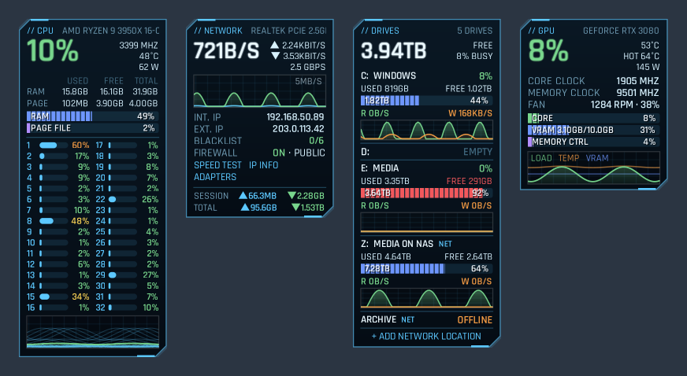
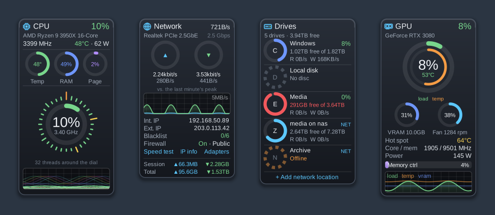
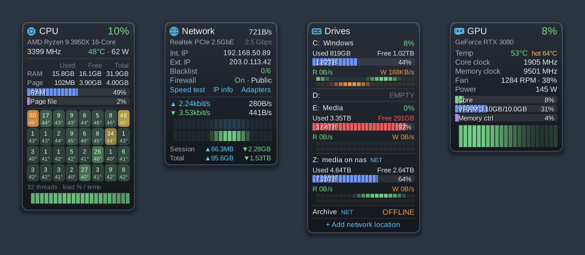
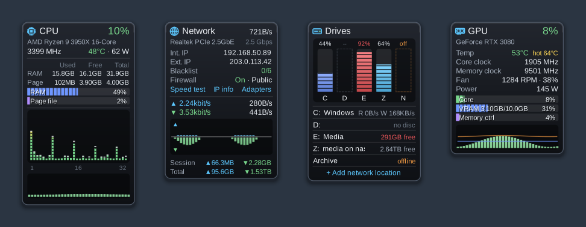
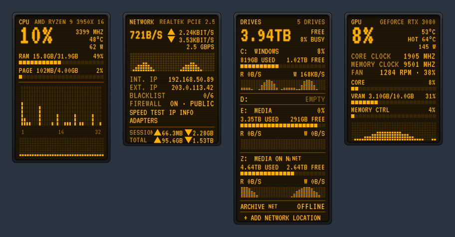
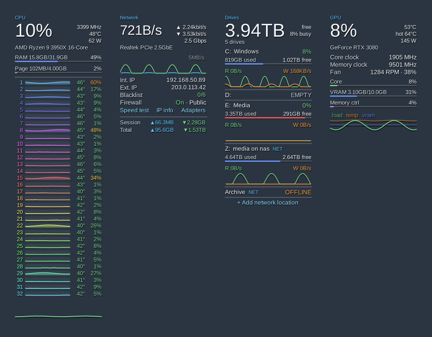
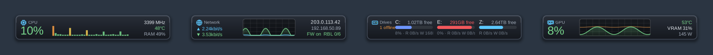

# DeskMeters

Desktop CPU, GPU, Network and Drives meters for Windows 10/11, in the style of the classic
8GadgetPack meters, with ten designs to choose from. One portable `.exe`; an installer is
the same file under a different name.



**[Download the latest release](../../releases/latest)**: `DeskMeters-Setup.exe` to install,
or `DeskMeters.exe` to run it portable.

- **CPU**: total load, clock, package temperature and power, RAM and page file, a row per
  thread (or per core, a heat grid, equalizer bars or a dial) with temperatures, and a graph.
- **GPU**: load, temperature and hot spot, core and memory clocks, fan, power, VRAM,
  memory-controller and video-engine load, and a graph. NVIDIA, AMD and Intel.
- **Network**: adapter and link speed, internal and external IP (click to copy), DNS
  blacklist check, Windows Firewall state and profile, up/down rates, a graph, and session
  and all-time totals.
- **Drives**: used/free space, activity %, read/write rates and a graph per drive, plus
  your mapped network drives and any shares you add (`\\server\share`).

## Installing

Download **DeskMeters-Setup.exe** from [Releases](../../releases/latest) and run it. It installs for the current user into
`%LocalAppData%\Programs\DeskMeters` (no administrator rights needed for the files), adds a
Start Menu shortcut and an entry in *Apps & features*, and by default sets DeskMeters to
start with Windows **with temperatures enabled**. That last part creates a scheduled task
that runs it as administrator at sign-in, so you'll see one Windows security prompt during
setup and never again. Decline it and DeskMeters still starts with Windows, just without
temperatures.

The exe isn't code-signed, so SmartScreen may warn the first time: **More info → Run anyway**.

To uninstall: *Apps & features → DeskMeters*, or run `DeskMeters.exe --uninstall`.

### Portable use

Just run **DeskMeters.exe** from wherever you keep it. Tray → **Start with Windows** sets
up the same startup task the installer does.

### Temperatures

Loads, clocks, memory, network and drives work as a normal user. **Temperatures need
admin** (Restart as administrator in the tray menu, or the startup task). GPU temperatures
work straight away. **CPU temperatures also need the free PawnIO driver**, which
LibreHardwareMonitor uses in place of the old WinRing0 driver:

```
winget install namazso.PawnIO
```

or download it from https://pawnio.eu/. The CPU meter tells you which of these is missing.
On a Ryzen 3000/5000 CPU, per-thread temperatures are the CCD temperature for that
thread's chiplet (Zen 2/3 doesn't report per-core temperatures). On Intel they're true
per-core readings.

## Designs

Tray icon → **Design**. Every meter follows it; right-click a meter → **Design for this
meter** to give one its own.

| Design | Look |
| --- | --- |
| Classic Refined (default) | The dark glass look, tidied up, with a soft shadow |
| Light | White panels, darker accents, stats in small tiles |
| Terminal | Green on black, monospace, bars made of block characters |
| Sci-fi HUD | Cyan outlines with clipped corners, big glowing numbers, segmented bars |
| Ring Gauges | A CPU dial with every thread as a tick; rings for temperature, memory, fan and drives |
| Heatmap | Threads as a grid of tiles coloured by load; history as heat strips |
| Equalizer | Threads as stereo bars with peak caps; upload and download mirrored |
| Retro LCD | Amber pixel display in a dark bezel, lit and unlit segments |
| Floating | No panels: text and lines straight on the wallpaper |
| Taskbar Strip | Short, wide panels that snap side by side along a screen edge |

Rajdhani (HUD) and VT323 (LCD) are bundled; Terminal uses Consolas, which ships with Windows.

<details>
<summary>Screenshots of every design</summary>

**Classic Refined**


**Light**



**Terminal**



**Sci-fi HUD**



**Ring Gauges**



**Heatmap**



**Equalizer**



**Retro LCD**



**Floating**



**Taskbar Strip**



</details>

### Compact layout

Every design comes in two sizes. **Compact layout** (tray menu, on by default) sizes the
meters like the 8GadgetPack gadgets: about 150 px wide at 100 % scaling, 11 px thread rows,
brighter and bolder text, and a solid panel so Windows can draw the text with ClearType
(**Sharper text**, also in the tray menu). Turn Compact layout off for the original, roomier
size. When the size changes, meters on the right half of a screen keep their right edge,
those on the left keep their left edge, and stacked or side-by-side meters stay together.

## Using the meters

| Do this | What happens |
| --- | --- |
| Drag a meter | Moves it; snaps to screen edges and other meters. Hold **Shift** to place freely |
| Right-click a meter | Its own options, design, position, size, opacity, hide, lock |
| Double-click a meter | Brings all meters to the front for 5 seconds |
| Click an IP address | Copies it |
| Click the blacklist result | Rechecks the external IP and blacklists |
| Click a drive name | Opens it in Explorer |
| **+ Add network location** (Drives) | Adds a share or mapped drive letter; remove it from the right-click menu |
| Click or right-click the tray icon | All settings |
| Double-click the tray icon | Brings all meters to the front for 5 seconds |

### Tray menu

- Show/hide each meter; **Design**; position, size and opacity of all meters at once.
- **Compact layout** (gadget-sized, default) and **Sharper text** (ClearType).
- **Update every** ½ s to 5 s.
- **Units**: °C or °F; network speed in bits or bytes.
- **Lock positions**, **Snap to edges**, **Click-through** (the mouse ignores the meters
  until you turn it off here).
- **While a full-screen app or game is running**: keep the meters on top of it (default,
  like the old sidebar gadgets), hide them, or do nothing special. A game in *exclusive*
  full-screen mode draws straight to the display and nothing can appear over it; switch
  the game to borderless/windowed full-screen if you want the meters visible in it.
- **Start with Windows**, **Restart as administrator**, **Open settings folder**,
  **Reset all settings**, **About**.

### Per-meter options

- **CPU**: thread display (one or two columns, physical cores, heat grid, equalizer, dial,
  hidden), memory, history graph.
- **GPU**: which card (if there are several), clocks, history graph.
- **Network**: adapter, details, links, totals, recheck, reset totals.
- **Drives**: add/remove network locations, mapped drives, hide empty drives, rates, graphs.

**On the desktop** mode keeps the meters behind your windows. When you show the desktop
(Win+D or the corner of the taskbar), they come forward so you can still see them.

## Network drives

Mapped drives show up on their own. To add any other share, click **+ Add network
location** and enter `\\server\share` or a drive letter like `Z:`. DeskMeters checks it can
reach it first and offers to add it anyway if it's offline.

- Shares are checked every 15 seconds on a separate thread with a timeout, so a sleeping
  NAS shows **Offline** instead of freezing the meters.
- Read/write rates come from Windows' SMB client counters, so they appear once the share
  is in use.
- When DeskMeters runs as administrator, Windows hides drive letters that were mapped in
  your normal session. DeskMeters reads your remembered mappings from the registry and talks
  to the share directly, so persistent mappings still appear. A letter mapped without
  "Reconnect at sign-in" won't; add its `\\server\share` path instead.

## Files

- Settings: `%APPDATA%\DeskMeters\settings.ini` (delete it to reset everything)
- Log: `%APPDATA%\DeskMeters\DeskMeters.log`

## Network lookups

DeskMeters contacts the network only to read the external IP from `api.ipify.org`
(falling back to `checkip.amazonaws.com` and `icanhazip.com`) every 15 minutes, and to
check that IP against public DNS blacklists every 6 hours. Some lists refuse queries that
come through public resolvers such as 8.8.8.8; those are skipped, which is why the ratio is
"listed / lists that answered".

## Building from source

Needs the .NET SDK 8 or newer (`winget install Microsoft.DotNet.SDK.8`). Then:

```powershell
.\build.ps1
```

The result is `dist\DeskMeters.exe` and `dist\DeskMeters-Setup.exe` (the same file; a
file name containing "Setup" starts the installer, as does `--install`). It targets .NET
Framework 4.8, which ships with Windows 10/11, so nothing else needs installing.

LibreHardwareMonitor and its dependencies (`lib\`) and the two fonts (`fonts\`) are
embedded in the exe and loaded from memory at startup (see `src\Program.cs` and
`src\Fonts.cs`).

### Layout

```
src\Program.cs          entry point, single instance, setup routing, embedded DLL loader
src\MeterApp.cs         tray icon, meters, default layout, settings, actions
src\MeterWindow.cs      layered window base: drawing, dragging, snapping, menus, headers
src\Skin.cs             the ten designs (colours, fonts, styles, layout)
src\Theme.cs            drawing primitives driven by the current skin
src\Fonts.cs            bundled fonts
src\Sampler.cs          background polling thread → one snapshot per tick
src\Sources\            LibreHardwareMonitor, perf counters, network, drives, lookups
src\Meters\             the four meters and their layout variants
src\Installer.cs        install / uninstall logic
src\SetupForm.cs        the setup window
src\Autostart.cs        scheduled task / Run key
lib\                    LibreHardwareMonitor 0.9.6 (net472 build) and dependencies
fonts\                  Rajdhani Medium/SemiBold, VT323 (OFL)
```

## Licence

DeskMeters is released under the [MIT Licence](LICENSE). Bundled third-party components keep
their own licences (below).

## Credits

Hardware sensors come from [LibreHardwareMonitor](https://github.com/LibreHardwareMonitor/LibreHardwareMonitor)
(MPL-2.0), bundled unmodified. Fonts: Rajdhani (Indian Type Foundry) and VT323 (Peter Hull),
both under the SIL Open Font License; see `licenses\`.
